# EduCentre full system audit — baseline

Status: **BASELINE (before implementation)**, 2026-10-27. This file will be updated in place with the final verified state; the baseline section is kept for history.

Companion files: [REFERENCE_FEATURE_PARITY_MATRIX.md](REFERENCE_FEATURE_PARITY_MATRIX.md), [reference-feature-parity-matrix.json](reference-feature-parity-matrix.json).

## Update 2026-10-27 — offline admission delivered

Offline admission is delivered: a Student can be admitted with no email, password or Auth account, and a portal login can be activated later. See section 1 for the original gap.

**Schema check (read-only, before any change).** The database matched the repository:
- All 52 applied migration versions match the repository files.
- All 98 functions match by name. Their bodies are identical apart from line endings, except one cosmetic encoding difference in a label inside `coaching_demo_command`, which affects demo seed text only.

**Migration `20261027032838_offline_student_records`** (applied):
- Drops `profiles_id_fkey`, so a Student no longer needs a row in `auth.users`.
- Adds the `student_login_links` table, with no direct client access.
- Adds three Teacher-only functions:
  - `coaching_create_offline_student`
  - `coaching_prepare_student_login`
  - `coaching_student_login_state`
- Changes `coaching_student_admission_read` to an outer join, so a Student without a login can still be read.
- Makes the signup trigger leave an existing profile unchanged, and refuse any other signup that uses an email reserved for an offline Student.
- Leaves every existing id and relationship untouched.

**How a login is linked later.** The server creates the Auth user with the Student's permanent id. This was proven on the live Auth service with a throwaway user, which was then deleted. The Student then receives the standard verification invitation and chooses a password. Records are never copied, re-pointed or matched by name or email.

**Verification**

| Check | Result |
|---|---|
| Rollback transaction on production (nothing committed) | 22/22 pass. Idempotency, enrollment and duplicate rejection, BDT 1,000 + 1,500 leaving BDT 500 due as separate transactions, overpayment rejected, receipt snapshots, the reserved-email and duplicate-login guards, the hostile signup blocked, the linked login seeing its original roll, enrollment and 3 payments, other Students' records denied, anonymous and student calls denied, genuine records unchanged |
| Browser E2E (`scripts/verify-offline-admission.mjs`) | 24/24 pass, run on a local app connected to the production database. Evidence: `docs/evidence/2026-10-27/offline-admission.json` |
| Automated checks | 762 tests, typecheck, lint (0 errors) and build all pass |

**Not physically verified**
- Completing a real invitation requires an inbox the Student owns. The linking path itself was verified inside the rollback transaction.
- Payments were not recorded for the browser-test Student, so that genuine finance totals stay clean.

**Existing behaviour noted.** A receipt that is issued later freezes the balance at the time of issue, not at the time of payment.

**Prepared but not applied.** These migrations are held in `supabase/drafts/` until their interfaces exist:
- Exam attendance and details
- Syllabus hierarchy with progress
- Batch profile with fee rules and concessions

## 1. Executive summary

EduCentre is an established production system, not a prototype. HEAD is `c1952bf` on `feature/p00-foundation`, which is also the deployment source. It has:

- 52 additive migrations
- 146 API route handlers
- 756 passing automated tests, re-run today
- a live deployment at https://educentre-iota.vercel.app, where health returns 200 and an anonymous Teacher API request is rejected with 401

The finance core already follows the target model. Student → enrollment → monthly due → many payments → immutable receipts. It is integer paisa, idempotent, row-locked, and rejects overpayment, with waivers and refunds as separate audited adjustments. **The finance core should be reused, not rebuilt.**

The real gaps are in the **academic and batch domain**. The schema cannot yet represent most of what the offline workflow needs:

| Area | Gap (verified from schema, not docs) |
|---|---|
| Batches | Only `code, name, starts_on, ends_on, capacity, is_archived`. No cover photo, subject, level, session, description, schedule summary, default monthly fee, admission fee, or lifecycle status (draft/active/completed/archived). |
| Fee configuration | `fee_plans` has one amount per batch per month (so month-specific fees work). There is no default fee with an effective-from date, no student-specific concession (only per-due waivers), and no fee change history. |
| Syllabus | `syllabus_units` is a flat list (`subject_id, title, position`). No chapter → topic hierarchy, status, weight, planned or completed dates, or progress calculation. |
| Exams | `exams.status` is only `draft / published / archived`. No pass marks, instructions, syllabus coverage, or the requested lifecycle. `exam_results` has no attendance field. **Absent cannot be recorded**, because a published result requires marks. |
| Academic PDFs | No student progress report PDF and no batch result-sheet PDF. Previous audits confirm this; only payment receipts have a PDF. |
| Offline admission | `profiles.id` references `auth.users`, so a genuine student needs an Auth identity (email signup) before admission. The "admit now, link credentials later" flow exists only in the isolated demo workspace. |

## 2. Architecture (actual)

- Next.js 16.4.2 App Router, React 19.2.8, TypeScript 6. Motion 14, React Three Fiber 9 and drei 10 are already installed. Receipts use pdf-lib with fontkit and Noto Sans Bengali.
- Route handlers in `src/app/api/v1/{public,student,teacher}`. Server adapters live in `src/server/http/production-*.ts`, with pure validators and contracts in `src/server/http/*.mjs`.
- All writes go through `SECURITY DEFINER` RPCs (`coaching_*`). These check the active role, take row locks, run inside one transaction, record an idempotency anchor (`financial_operations` / `coaching_mutation_receipts`), and write an audit log. **Clients have no direct table write grants.**
- Writes are also gated by `COACHING_ENABLE_MUTATION_APIS`, a browser-origin/CSRF marker and a bearer JWT.
- Supabase project `rkpwqgwceekuvlizfpeb` (PostgreSQL 17). Storage uses private buckets for photos, documents, learning PDFs and unpublished CMS media.

## 3. Database ERD (current)

```mermaid
erDiagram
  AUTH_USERS ||--|| PROFILES : "id (cascade)"
  PROFILES ||--o| STUDENT_DETAILS : student_id
  PROFILES ||--o| STUDENT_GUARDIANS : student_id
  PROFILES ||--o| STUDENT_ADMISSION_DETAILS : student_id
  PROFILES ||--o| STUDENT_APPLICATION_WORKFLOWS : student_id
  PROFILES ||--o| TEACHER_PROFILES : id
  MEDIA_ASSETS ||--o{ STUDENT_DETAILS : photo_media_id
  PROFILES ||--o{ ENROLLMENTS : student_id
  BATCHES ||--o{ ENROLLMENTS : batch_id
  BATCHES ||--o| BATCH_ADMISSION_POLICIES : batch_id
  BATCHES ||--o{ FEE_PLANS : "batch_id, bill_period unique"
  FEE_PLANS ||--o{ MONTHLY_DUES : fee_plan_id
  PROFILES ||--o{ MONTHLY_DUES : "student_id (student,batch,period unique)"
  MONTHLY_DUES ||--o| STUDENT_DUE_BREAKDOWNS : due_id
  MONTHLY_DUES ||--o{ PAYMENTS : due_id
  FINANCIAL_OPERATIONS ||--|| PAYMENTS : operation_id
  MONTHLY_DUES ||--o{ PAYMENT_ADJUSTMENTS : "waiver/refund/correction"
  PAYMENTS ||--o{ PAYMENT_ADJUSTMENTS : payment_id
  PAYMENTS ||--o| PAYMENT_RECEIPTS : "immutable snapshot"
  MONTHLY_DUES ||--o{ STUDENT_PAYMENT_CLAIMS : "student-reported, pending until verified"
  PAYMENTS ||--o| STUDENT_PAYMENT_CLAIMS : payment_id
  BATCHES ||--o{ ACADEMIC_SUBJECTS : batch_id
  ACADEMIC_SUBJECTS ||--o{ SYLLABUS_UNITS : "flat, position"
  ACADEMIC_SUBJECTS ||--o{ ROUTINE_SLOTS : "gist no-overlap"
  ACADEMIC_SUBJECTS ||--o{ EXAMS : "(subject_id,batch_id)"
  EXAMS ||--o{ EXAM_RESULTS : "exam,student unique"
  ACADEMIC_SUBJECTS ||--o{ ACADEMIC_ASSIGNMENTS : subject
  ACADEMIC_ASSIGNMENTS ||--o{ ASSIGNMENT_SUBMISSIONS : assignment_id
  BATCHES ||--o{ BATCH_CONTENTS : "materials/notes"
  LEARNING_MATERIAL_UPLOADS ||--o{ BATCH_CONTENTS : verified upload
  BATCHES ||--o{ ANNOUNCEMENTS : batch_id
  PROFILES ||--o{ NOTIFICATIONS : recipient
  SITE_PAGES ||--o{ SITE_PAGE_SECTIONS : page
  SITE_PAGE_SECTIONS ||--o{ SITE_SECTION_ITEMS : section
  BATCHES ||--o{ OFFICE_EXPENSES : batch
  OFFICE_EXPENSES ||--o| OFFICE_EXPENSE_REVERSALS : expense
```

### Integrity findings

- **Deletion safety is good.** Every finance, academic and enrollment foreign key uses `ON DELETE RESTRICT`. The only cascades are `auth.users → profiles` and `profiles → teacher_profiles / teacher_preferences`. Deleting an Auth user who has enrollments, dues or payments therefore fails at the restricting foreign keys, so financial history cannot disappear through a cascade.
- **Duplicates are blocked by unique constraints:**
  - one enrollment per (student, batch)
  - one due per (student, batch, period) and per (fee plan, student)
  - one fee plan per (batch, period)
  - a unique `operation_id` per payment and adjustment
  - one result per (exam, student)
  - a partial unique index on claim references
- **Money is exact.** It is stored in `bigint` minor units (paisa), BDT only, and bounds-checked. Marks use `numeric(10,2)`.
- **Batch delete:** batches are never physically deleted; `is_archived` is used. No lifecycle status exists yet. See the gap table above.

## 4. Security / RLS findings

- RLS is enabled on every public table. Effective grants have no client INSERT/UPDATE/DELETE (2026-10-20 read-back). Closed tables intentionally have no policies, and access goes through reviewed RPCs. This is not a defect and must not be "fixed" by opening policies.
- Student reads go through RPCs that check `auth.uid()`, active account and active enrollment. Private notes are redacted from Student reads (`coaching_student_workflow_read`).
- Open advisories carried forward: `btree_gist` sits in the public schema, and leaked-password protection is disabled. Neither is changed in this task without the owner's decision.
- Anonymous access to `/api/v1/teacher/overview` returns 401 in production (checked today).

## 5. Financial integrity findings (baseline)

| Invariant | Status | Evidence |
|---|---|---|
| Multiple payments per monthly due | VERIFIED (prior) | `payments.due_id` is many-to-one. Demo evidence: BDT 3,000 paid as 2 × 1,500 (`docs/evidence/2026-10-22/demo-workspace.json`) |
| Overpayment rejected | VERIFIED (prior) | `coaching_post_payment` raises `PAYMENT_EXCEEDS_BALANCE` under a row lock |
| Idempotent writes | VERIFIED (prior) | `financial_operations` anchor; a mismatched replay raises `IDEMPOTENCY_CONFLICT` |
| Pending ≠ collected | VERIFIED (prior) | Student claims stay in `student_payment_claims` until a Teacher verifies them, which then creates a `payments` row |
| Immutable receipts with balance snapshot | VERIFIED (prior) | `payment_receipts` with the `coaching_receipt_immutable` trigger; the snapshot holds charge, paid, waived, refunded and balance |
| Refund / waiver auditable | VERIFIED (prior) | `payment_adjustments` (kind, reason, operation, actor) |
| Outstanding = charge − payments + refunds − waivers | PARTIAL | Logic is duplicated across several RPCs (post, waive, statement, receipt). A shared SQL helper and a reconciliation test are needed |
| Default fee / effective-from / concessions | MISSING | See section 1 |

"VERIFIED (prior)" means evidence exists from 2026-10-20/22 and the contract tests pass today. The physical E2E scenarios in the task (A–L) still have to be re-run against the current build.

## 6. UI/UX baseline

These need a physical browser pass at 360/375/768/1440/1920 before they can be classified:

- Teacher portal: a single `PortalClient` with tabbed studios
- Student directory and finance studio
- Academic studio
- Materials
- CMS (`WebsiteAdminStudio`, `CmsContextWorkspace`)
- Student experience

Earlier axe scans reported zero violations on the tested screens only.

## 7. Prioritized remediation plan

1. **P0 — schema-dependent academic workflow** (one additive migration plus RPCs):
   - exam attendance (`attempted / absent / not_recorded`), pass marks, instructions, coverage and the guarded lifecycle
   - syllabus chapter → topic hierarchy with status, weight and dates, plus a weighted progress RPC
2. **P0 — batch profile:** cover media, subject/level/session, description, schedule, default monthly fee, admission fee and lifecycle status. Draft-only batches can be deleted; batches with history are archived.
3. **P1 — fee rules:** default fee with effective-from, and student concessions that only affect future generated dues, with history. Shared balance helper and reconciliation test.
4. **P1 — academic PDFs:** student progress report and batch result sheet, reusing the receipt PDF pipeline (pdf-lib, Bangla font, A4).
5. **P1 — offline admission without Auth:** decide between (a) decoupling student records from `auth.users` with later linking, or (b) keeping the current invite-first flow. Option (a) is a significant foreign-key change and needs owner sign-off.
6. **P2 — mobile-first portal polish:** run Scenario L across the touched screens.
7. Then re-run scenarios A–L against production and update this report.

## 8. Blocker found at baseline

Items 1–5 require applying migrations to Supabase project `rkpwqgwceekuvlizfpeb`. This workspace has no usable database connection: there is no Supabase CLI login, no access token, no DB password, and no Supabase MCP server in this session. Docker is not running, so a local Postgres replay isn't possible either.

Deploying application code that calls RPCs which aren't applied yet would break production. So schema-dependent work cannot be shipped until database access is provided.
